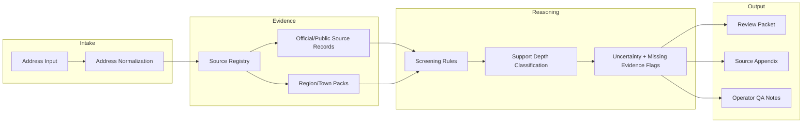

# System Architecture

This diagram outlines how property records move from an address search into a report.

## Layers

### Frontend

The interface handles the search and explains results, missing records and limits.

### Backend

API services for address handling, screening, report generation, source registry access, and operational dashboards.

### Packs

Reusable regional and town-specific context packs. Packs separate local source coverage from generic defaults.

### Validation

Release gates and support-depth checks prevent the product from overstating what the source set can actually prove.

## Responsibilities

Record retrieval, routing rules, supported claims and report wording are separate parts of the system.
